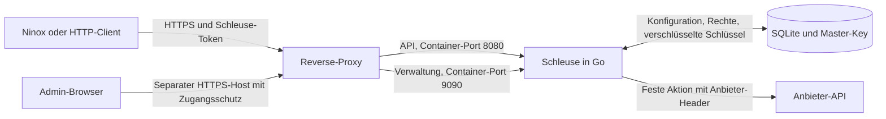

# Schleuse verstehen und weiterentwickeln

Schleuse hält den Schlüssel einer Anbieter-API aus dem Client heraus. Ein Administrator konfiguriert das Ziel, die erlaubte Aktion und die persönlichen Zugänge. Der Client verwendet einen eigenen Schleuse-Token für die freigegebenen Aktionen. Erst bei der Weiterleitung setzt Schleuse den Anbieter-Schlüssel in den vorgesehenen Header ein.

## Aufbau im Paket

| Bereich | Verantwortung |
|---|---|
| [`cmd/gateway`](../cmd/gateway/main.go) | Prozessstart, getrennte Listener, Healthcheck und optionaler Demo-Modus. |
| [`internal/app`](../internal/app/app.go) | Anmeldung, Sitzung, API-Routing und Prüfung der Aktionsfreigaben. [`manage.go`](../internal/app/manage.go) verwaltet Konfiguration und Rechte. [`proxy.go`](../internal/app/proxy.go) prüft Ziel, Anfrage und Antwort. [`store.go`](../internal/app/store.go) hält Datenmodell und Schlüsselverwaltung. |
| [`web`](../web/src/App.vue) und [`internal/ui`](../internal/ui/ui.go) | Vue-Oberfläche und Einbettung des gebauten Frontends in das Go-Programm. Im laufenden Container braucht es keinen Node-Dienst. |
| [`compose.yaml`](../compose.yaml) und [`install-server.sh`](../install-server.sh) | Container, persistentes Volume, Portauswahl und lokale Veröffentlichung der beiden Listener. |

## Vertrag und Datenfluss

1. **Verbindung** legt Ziel-URL, Kundenzuordnung, Anmeldeart (Header, Basic, URL-Parameter oder ohne Schlüssel) und feste Zusatz-Header fest. SQLite speichert den Schlüssel AES-GCM-verschlüsselt. Der separate Master-Key auf dem Server ist zur Entschlüsselung nötig.
2. **Aktion** verknüpft die Verbindung mit einem Aktionsnamen, einer HTTP-Methode und einem Zielpfad. Der Pfad kann Platzhalter wie `{id}` und feste Query-Parameter enthalten. Dazu kommen freigegebene Query-Parameter und für Schreibaktionen entweder erlaubte einfache Felder oder eine Body-Vorlage mit `{{platzhaltern}}`. Neue Aktionen sind inaktiv, bis der Admin sie aktiviert.
3. **Zugang** erfolgt über einen API-Token (`slt_…`) für eine oder mehrere Aktionen eines Kunden, unbegrenzt oder befristet, oder über einen persönlichen Zugang mit `POST /auth/login` und 15-Minuten-Token. Die Verwaltung hat ihre eigene Anmeldung mit HttpOnly-Cookie und CSRF-Prüfung.
4. **Aufruf** erfolgt an `/actions/<aktionsname>` mit der erlaubten Methode und `Authorization: Bearer <token>`. Schleuse prüft Token, Freigabe, Kundenzuordnung, Platzhalterwerte, Query-Parameter und Body. Es baut die Anfrage zur Ziel-API neu auf und übernimmt keine Client-Header. Zielhost, Port und aufgelöste Adressen werden vor dem Verbindungsaufbau geprüft.
5. **Antwort** wird auf Größe, JSON oder kurzen Text und eine mögliche Rückgabe des Schlüssels geprüft. Kurzer Text wird als `{"text": …}` zurückgegeben. Redirects werden gesperrt. `X-Gateway-Source` und `X-Request-ID` helfen bei der Diagnose. Die Ereignisse speichern Status, Quelle und Dauer, keine Bodies oder Schlüssel.

Die Konnektor-Vorlagen liegen als JSON in [`internal/app/connectors`](../internal/app/connectors) und werden in das Programm eingebettet. Die Verwaltung liefert sie über `GET /api/templates`. Der öffentliche `GET /healthz` prüft nur die Erreichbarkeit von Schleuse.

## Grenzen und nächste sinnvolle Arbeit

- **OAuth-Anbieter.** Google, Microsoft 365 und Apps mit kurzlebigen Tokens brauchen einen gespeicherten Refresh-Token oder Client-Credentials mit automatischer Erneuerung.
- **Vorlagen mit echten Konten prüfen.** Die meisten Vorlagen folgen der Anbieter-Dokumentation. Jede geprüfte Vorlage bekommt den Status `getestet`.
- **Reverse-Proxy-Vertrauen und Betrieb.** Das Login-Limit verwendet die direkte Gegenstelle. Hinter einem Proxy teilen sich Clients das Limit. Backups, Restore-Tests und Lasttests sind die nächsten Betriebsthemen.
- **Verwaltung nachvollziehbar machen.** Änderungsprotokoll, mehrere Admin-Rollen und kontrollierte Schlüsseldrehung. Einen kompromittierten Host kann die Verschlüsselung der gespeicherten Daten nicht abfangen.

## Entwicklungsablauf

1. [`README.md`](../README.md) lesen und die Demo mit `./start-local.sh --demo` starten. In einem zweiten Terminal `python3 scripts/demo-client.py` ausführen.
2. Go 1.27.3+, Node 22.12+, npm und Python 3.9+ für `./test.sh` bereitstellen. Das Skript baut Vue, prüft Installer und Paket, führt die Go-Tests mit Race Detector aus und erstellt das lokale Binary.
3. Bei Änderungen an Authentifizierung oder Weiterleitung die Trennung von Verwaltung, Kunden und Anbietern prüfen. Bei Datenänderungen einen Bestand aus der vorherigen Version in einer Testinstallation weiterverwenden. Bei Infrastrukturänderungen den [Installationsablauf](INSTALLATION.md) mit einer frischen Instanz und einem Update eines bestehenden Volumes testen.
4. Mit `./package-server.sh --format zip` ein neues Weitergabepaket bauen und aus einer frischen Entpackung prüfen. Für einen Umzug einer konkreten Installation ist zusätzlich das separat geschützte Betriebsbackup nötig.
